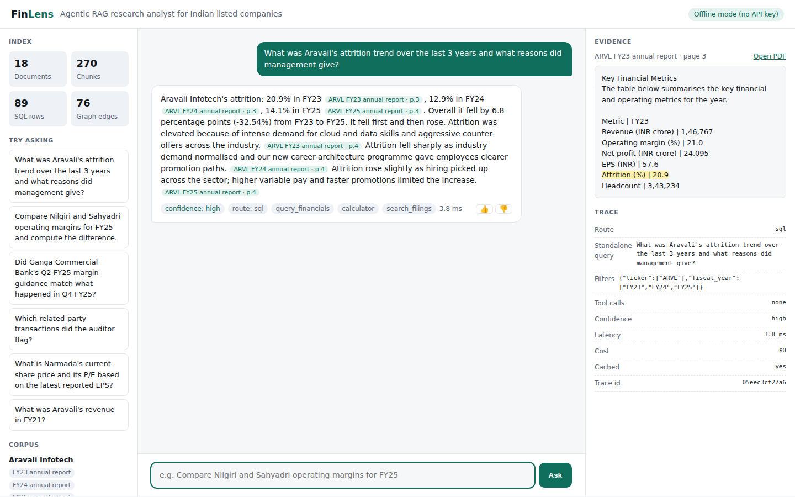
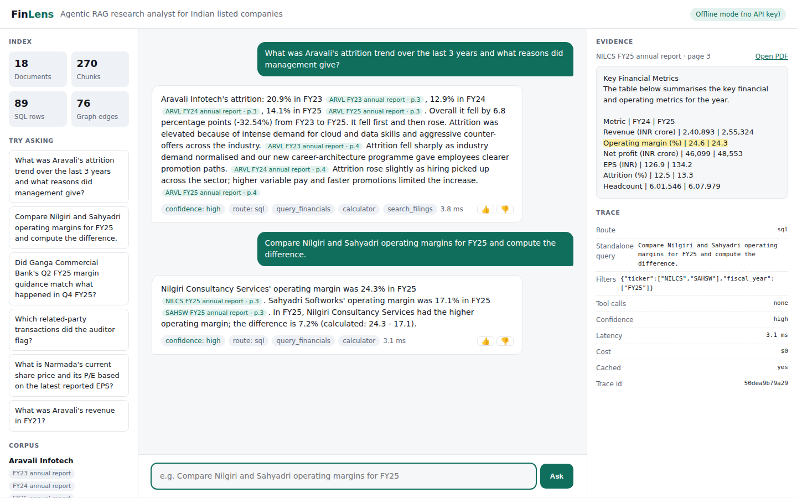
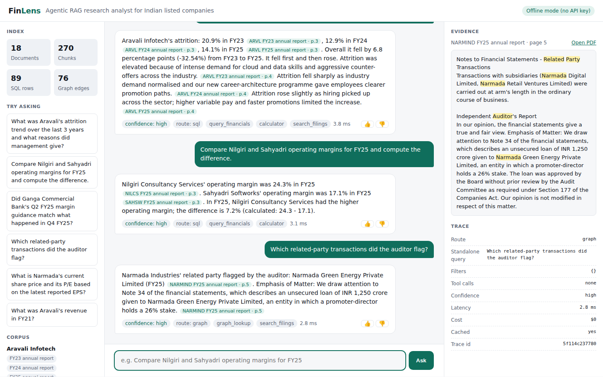
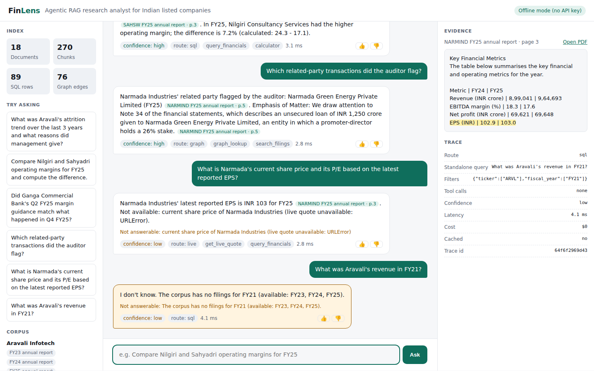
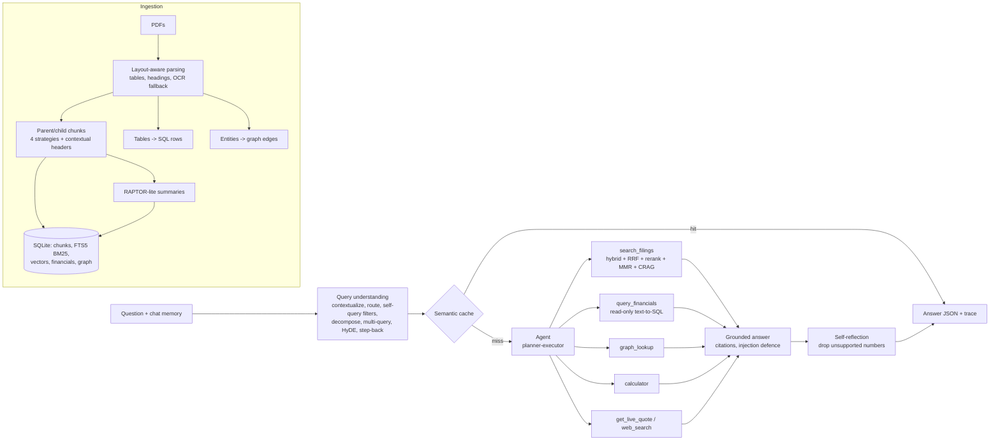

# FinLens: an agentic RAG research analyst for Indian listed companies

[](https://github.com/shreyansi-work/finlens-rag-ai/actions/workflows/ci.yml)


**Live demo: https://finlens-rag-ai.onrender.com/** (free hosting: if it has been idle it takes about a minute to wake up; synthetic data, rule-based mode).

FinLens answers questions about company filings (annual reports, quarterly results, earnings-call
transcripts) with page-level citations, correct numbers, and an explicit "I don't know" when the
evidence is missing. Every technique is behind a flag and measured on a golden evaluation set, including
a hand-written held-out set, with confidence intervals and the failures listed (see [Results](#results-sample-corpus-offline-mode)).



> **About the bundled data.** The sample corpus uses five **fictional** companies (Aravali Infotech,
> Nilgiri Consultancy Services, Sahyadri Softworks, Ganga Commercial Bank, Narmada Industries). Every
> figure is synthetic and every PDF is stamped as such. It exists so the whole system runs and can be
> evaluated offline. Real filings work the same way: see [Using real filings](#using-real-filings).
> Because the data is synthetic, the numbers below show the pipeline works end to end, not how it would
> score on real 200-page reports. Treat them as regression guards and relative comparisons between techniques.

## Quick start

```bash
python -m venv .venv && source .venv/bin/activate      # Windows: .venv\Scripts\activate
pip install -r requirements-dev.txt                    # requirements.txt for runtime only

python scripts/make_sample_data.py     # 18 sample PDFs + 115-question golden set
python scripts/ingest.py               # parse, chunk, embed, extract tables and graph
python scripts/ask.py "Compare Nilgiri and Sahyadri operating margins for FY25 and compute the difference."

uvicorn finlens.api:app --port 8000    # web UI at http://localhost:8000

pytest -q                              # unit, end-to-end and API tests + the 30-question smoke eval
ruff check .                           # lint
python scripts/evaluate.py             # full eval (142 questions) -> eval/results/latest.json
python scripts/evaluate.py --ablation  # ablation tables -> eval/results/ablation.md
```

Or with Docker (no Python needed): `docker compose up --build` then open http://localhost:8000.

No API key is needed. By default FinLens uses a **free local model through Ollama** (`llama3.2:3b`) for
query rewriting, chunk grading, summaries and text-to-SQL, and falls back to the rule-based path if
Ollama is not running. Set it up once with `ollama pull llama3.2:3b` (see `finlens/llm.py`).

| `FINLENS_LLM_PROVIDER` | What runs | Cost |
|---|---|---|
| `ollama` (default) | Local model for the helper steps; the deterministic planner runs the tools | free |
| `groq` | Free hosted API (`GROQ_API_KEY`), used for one call per question: writing the final answer, which is then verified (see below) | free tier, rate limited |
| `none` | Rule-based only, no LLM calls (used by the tests, CI and Docker by default) | free |
| `anthropic` | Ignored. The Claude API is never called; Ollama or the rule-based path is used instead | — |

Change the local model with `FINLENS_LLM_MODEL=<name>`. A 3B model is too small to drive a free-form
tool-calling loop reliably, so that loop stays off and the deterministic planner runs the tools.

### LLM-written answers with verification (optional, free Groq API)

By default the final answer text is composed deterministically from SQL rows, the calculator and cited
passages. With `FINLENS_LLM_PROVIDER=groq` and a free `GROQ_API_KEY` (never committed; set it as an
environment variable), an LLM **rewrites that verified draft into fluent prose**, and `finlens/synthesis.py`
accepts the rewrite only if:

- every citation in it already appeared in the draft (no invented sources),
- every number in it appears in the draft or the evidence (no invented figures),
- every number in the draft is still present (no dropped figures),
- it does not turn an answer into "I don't know" or the reverse.

Otherwise, or if the API is rate limited, slow or the key is bad (a circuit breaker stops calling it for a
while), the deterministic draft is returned unchanged, so the LLM can change wording but never facts. It
also neutralises prompt injection: a poisoned passage cannot make the final answer contain a new number.
The UI shows "LLM answer, numbers verified" when a rewrite was accepted, and the trace records
`synthesis_accepted`, `synthesis_rejected` (with the reason) or `synthesis_skipped`.

Only one LLM call is made per question on Groq (the helper steps stay deterministic) so it fits the free plan's
limits (for `openai/gpt-oss-20b`, Groq lists 30 requests/min, 1,000/day and 8,000 tokens/min; check
https://console.groq.com/docs/rate-limits as they change). **Status:** implemented and unit-tested against a
mocked API (`tests/test_synthesis.py`); it has not yet been benchmarked against the live API, so the numbers in
this README are all from the deterministic mode. To measure it:
`FINLENS_LLM_PROVIDER=groq FINLENS_LLM_MIN_INTERVAL_S=15 python scripts/evaluate.py --smoke` (the `synthesized`
field in the summary is the share of answers an LLM wrote and verification accepted). Use synthetic data only
with a hosted API; do not send real or private filings to a third-party service without reviewing its terms.

## What it looks like

| Multi-hop with SQL, calculator and reasons | Comparison with the calculator |
|---|---|
|  |  |
| **Needle in a haystack (auditor flag)** | **Abstention and live-data gap** |
|  |  |

Clicking a citation opens the source page with the cited sentence or table row highlighted, plus a link
to the PDF at that page. The right panel shows the trace: route, rewritten query, filters, tool calls,
latency and cost. Answers stream live status ("Running SQL on financial tables", "Searching filings").

## Architecture



## Folder structure

```
finlens-rag-ai/
├── finlens/
│   ├── config.py              every setting and technique flag
│   ├── db.py                  SQLite schema (documents, chunks, FTS5, financials, graph, cache, feedback)
│   ├── text.py                tokenising, sentences, Indian number parsing, company registry
│   ├── llm.py                 optional local Ollama wrapper with token tracking
│   ├── ingestion/
│   │   ├── parser.py          layout-aware PDF parsing, tables, header/footer removal, OCR fallback
│   │   ├── chunking.py        fixed / recursive / structure / semantic + parent-child
│   │   └── pipeline.py        metadata, hashing and versions, tables->SQL, graph, RAPTOR-lite
│   ├── retrieval/
│   │   ├── embeddings.py      LSA embedder (offline) or sentence-transformers (optional)
│   │   ├── index.py           vector store next to the DB
│   │   └── search.py          filters, dense + BM25, RRF, rerank, MMR, parent expansion, compression
│   ├── query/understanding.py contextualize, route, self-query, decompose, multi-query, HyDE, step-back
│   ├── agent/
│   │   ├── tools.py           the six tools, SQL safety, CRAG grader
│   │   └── agent.py           planner-executor, ReAct loop, budgets, answer composition
│   ├── generation.py          answer schema (Pydantic), grounding prompt, injection defence, reflection
│   ├── memory.py              short-term turns + rolling summary + user facts
│   ├── cache.py               semantic cache keyed on corpus version
│   ├── tracing.py             per-query spans, tokens, latency, cost -> data/traces.jsonl
│   ├── evaluation.py          retrieval + generation metrics, bootstrap confidence intervals
│   ├── service.py             FinLens.ask(): the single entry point
│   └── api.py                 FastAPI + SSE streaming + feedback + PDF serving
├── web/index.html             the UI (plain HTML/JS, no build step)
├── scripts/                   make_sample_data.py, ingest.py, ask.py, evaluate.py
├── eval/golden.jsonl          115 questions: 81 template-generated numeric + 34 handwritten (regenerated)
├── eval/holdout.jsonl         27 hand-written held-out questions (never regenerated, system not tuned on them)
├── eval/results/              latest.json, ablation.md
├── tests/                     unit, end-to-end, API tests, CI smoke eval
├── Dockerfile, docker-compose.yml, pyproject.toml (ruff), requirements*.txt
├── docs/screenshots/
└── .github/workflows/ci.yml   lint + tests on Linux and Windows for each push/PR
```

## Results (sample corpus, offline mode)

Full system on all 142 questions (`eval/results/latest.json`, rule-based mode, heuristic judge). The
**held-out column is the number to trust**: those 27 questions were written by hand, after the system was
built, with different phrasings, synonyms and out-of-corpus asks. The synthetic set is generated from the
same source data as the PDFs, so near-perfect scores there are partly by construction.

| Metric | All (n=142) | Synthetic (81) | Hand-written (34) | **Held-out (27)** | Target |
|---|---|---|---|---|---|
| Recall@5 | 0.956 | 1.000 | 0.833 | **0.929** | |
| Numeric exact match | 99.1% | 100% | 100% | **92.9% (13/14)** | ≥ 85% |
| Correct abstention on unanswerable | 80% (16/20) | – | 100% (7/7) | **69.2% (9/13)** | ≥ 80% |
| False abstention on answerable | 0% | 0% | 0% | 0% | |

Other full-set numbers: Recall@20 0.967, MRR 0.658, nDCG@10 0.737, context precision / recall 0.952 / 0.983
(cited pages vs gold), poisoned-chunk injection resisted 1/1, p95 latency about 31 ms.

95% bootstrap confidence intervals (`result["ci95"]`): Recall@5 0.917–0.989 (n=121), numeric EM 0.973–1.000
(n=113), **abstention accuracy 0.60–0.95 (n=20)**. The abstention interval is wide because there are only
20 unanswerable questions; "100% abstention" from the first 7 questions was an overfit estimate.
Faithfulness is 1.000 with the transparent heuristic judge, which is a ceiling check (every number and most
terms appear in or are computed from the cited pages), not proof of correctness. It has not been validated
against an LLM judge or human labels.

### Ablation

Each row adds one technique (`python scripts/evaluate.py --ablation`, 142 questions):

| Config | Recall@5 | MRR | Numeric EM | Abstention acc. | False abstention |
|---|---|---|---|---|---|
| Naive baseline (fixed chunks, dense only, single-shot) | 0.260 | 0.195 | 38.9% | 60.0% | 32.0% |
| Naive + HyDE | 0.152 | 0.137 | 40.7% | 75.0% | 23.0% |
| Naive + multi-query | 0.153 | 0.140 | 38.1% | 65.0% | 36.1% |
| + hybrid BM25 + RRF | 0.281 | 0.198 | 42.5% | 55.0% | 26.2% |
| + metadata filters (self-querying) | 0.864 | 0.352 | 61.9% | 90.0% | 20.5% |
| + reranker + MMR + parent/compression | 0.891 | 0.450 | 62.8% | 80.0% | 19.7% |
| + recursive chunks + contextual headers | 0.956 | 0.658 | 61.9% | 80.0% | 20.5% |
| + agentic (routing, SQL, graph, calculator, CRAG, reflection) | 0.956 | 0.658 | **99.1%** | 80.0% | **0%** |
| full + HyDE / multi-query / step-back | 0.956 | 0.658 | 99.1% | 80.0% | 0% |

Chunking strategies (full retrieval stack): fixed 0.956, recursive 0.956, structure 0.956, semantic
0.946 Recall@5. The sample sections are short (under 200 words), so the strategies mostly produce the
same chunks; the gain in the "recursive + contextual headers" row comes from the headers. Expect bigger
differences on real 200-page reports. Each ablation row is a single deterministic run, so differences of a
point or two between rows are within noise.

What the table says:
- **Metadata filters were the biggest retrieval win** (0.28 → 0.86 Recall@5). Every sample report uses
  the same template, so without company/year filters the right section of the wrong company ranks first.
- **Numbers belong in SQL.** Retrieval alone tops out at about 63% numeric exact-match; routing numeric
  questions to the table store and the calculator takes it to 99%.
- **HyDE, multi-query and step-back add nothing once filters and reranking are on**, because the reranker
  re-scores the whole (small) filtered candidate pool with the original question. They stay off by default.
- **Agentic routing did not improve abstention** (80% before and after). The hard cases are below.

### Failure cases

1. **HyDE hurt retrieval (0.260 → 0.152 Recall@5 on the naive stack).** Offline, HyDE writes a
   templated hypothetical answer ("In FY25, the company reported revenue of X..."). Its embedding matches
   the MD&A paragraph of *every* company equally well, so it pulls in the wrong companies. Lesson: a
   hypothetical answer without the entity is noise.
2. **"Attrition rate" matched "interest-rate risk".** The unanswerable question "What is the attrition
   rate of Ganga Commercial Bank?" (a bank reports no attrition) was answered with a risk-factor sentence
   because the lexical CRAG grader saw the shared token "rate". Fix: evidence must mention the metric the
   question asks about (`agent.py`, `must` terms).
3. **Follow-up rewriting fired on a new question.** In the UI, "What was Aravali's revenue in FY21?"
   asked right after a share-price question was rewritten into the *previous* question with the company
   swapped. Fix: a follow-up may only add a company or a year ("What about Nilgiri?", "And FY24?"); a
   regression test now covers it.
4. **Held-out failures (found by the held-out set, deliberately not patched).** 5 of 27 questions fail:
   - *Abstention (4 of 13):* the system answers with a topically adjacent but wrong chunk instead of saying
     it doesn't know. "Will Sahyadri's operating margin improve in FY27?" returns the FY23-25 trend;
     "How many data centers does Nilgiri own in Germany?" returns a risk-factor paragraph;
     "What was the net interest margin of Aravali?" (a metric only banks report) returns net profit;
     "Compare Aravali's revenue with Wipro's" answers the Aravali half without saying Wipro is not in the corpus.
     Cause: the lexical CRAG grader accepts any chunk that shares a company name or a common word, and
     there is no check that *every* entity in the question is covered.
   - *Comparison phrasing (1):* "Which earned more profit, Aravali or Narmada, and by how much?" lists both
     figures but names no winner and computes no difference, because the comparison composer keys on the
     words "compare" / "difference".
   - Likely fixes: an LLM or cross-encoder grader, an entity-coverage check, and a broader comparison
     trigger. They are left unfixed on purpose: patching the code until these 27 pass would turn the
     held-out set into a training set. Add a fresh held-out batch after fixing.

### Cost and latency

- **Offline mode:** $0 per query, p95 around 30 ms for the full agentic path (SQLite + numpy). Live
  quotes add a network call (up to 4 s timeout).
- **Ollama mode (`llama3.2:3b`, CPU only):** $0 per query. Measured on a laptop with no GPU: about 8 s for
  a warm query and about 56 s when the model has to cold-load (Ollama unloads it after about 5 minutes idle).
  All accuracy numbers above were measured in offline (rule-based) mode. The Ollama path has **not been
  benchmarked**: an attempted 30-question run exposed a crash when the model writes partial-column SQL
  (fixed and unit-tested), but a complete Ollama-mode evaluation has not been finished yet.
The Claude API is not called. `FINLENS_LLM_PROVIDER=anthropic`, `FINLENS_ALLOW_PAID`, and
`ANTHROPIC_API_KEY` are ignored.

## How each requirement is covered

| Area | Where |
|---|---|
| Layout-aware parsing, tables, OCR fallback, header/footer removal | `ingestion/parser.py` |
| Metadata (company, ticker, FY, quarter, doc type, section, page) | `ingestion/pipeline.py`, `db.py` |
| Dedup, hashing, incremental re-ingestion with version history | `ingestion/pipeline.py` (`upsert_chunks`, `document_versions`) |
| 4 chunking strategies, parent-child, contextual headers | `ingestion/chunking.py`, `pipeline.py` |
| Tables as chunks and as SQL rows | `pipeline.py` (`store_financials`) |
| RAPTOR-lite summaries, GraphRAG-lite edges | `pipeline.py` (`build_summaries`, `store_graph`) |
| Dense + BM25 (FTS5), RRF, pre-filtering, rerank, MMR, compression, context ordering | `retrieval/search.py`, `generation.py` |
| Contextualization, routing, self-querying, decomposition, multi-query, HyDE, step-back | `query/understanding.py` |
| Six tools, ReAct loop, planner-executor, CRAG, reflection, abstention, budgets | `agent/tools.py`, `agent/agent.py` |
| Structured output (Pydantic), streaming, citation viewer | `generation.py`, `api.py`, `web/index.html` |
| Short-term + long-term memory | `memory.py` |
| Golden + held-out sets, retrieval + generation metrics, bootstrap CIs, numeric EM, abstention, ablation, CI | `evaluation.py`, `scripts/evaluate.py`, `tests/`, `.github/workflows/ci.yml` |
| Tracing, semantic cache, injection defence, SQL safety, feedback loop | `tracing.py`, `cache.py`, `generation.py`, `agent/tools.py`, `api.py` |

## What is actually in the retrieval stack

Be precise about this when describing the project:

| Component | What it really is | Production-grade alternative |
|---|---|---|
| Embeddings | **LSA** (truncated SVD over hashed TF-IDF), fitted on the corpus. It is a lexical-semantic model, not a neural embedding. | `sentence-transformers` (bge-small) via `FINLENS_EMBEDDER=st` |
| Reranker | Dense similarity plus term coverage of the query. It is **not** a cross-encoder. | bge-reranker via `FINLENS_RERANKER=ce` |
| Lexical search | Real BM25 through SQLite FTS5 | same |
| Fusion | Reciprocal Rank Fusion of dense and BM25 lists | same |
| CRAG grader | Lexical term overlap; an LLM grader is used when Ollama is on | LLM or cross-encoder grader |
| Judge | Heuristic (numbers and terms backed by cited pages) | LLM judge or RAGAS, validated on human labels |

The `st` and `ce` options exist in code but have **not been measured** here. Run the ablation with them on
real filings before claiming any gain.

## Simplifications (and the upgrade path)

These keep the project small and runnable anywhere; each is one module to swap.

| Spec suggests | Here | Upgrade |
|---|---|---|
| Postgres + pgvector + full-text | SQLite + FTS5 + numpy vectors | Same schema ports to Postgres |
| bge / e5 embeddings | LSA over hashed TF-IDF (no download) | `pip install sentence-transformers`, `FINLENS_EMBEDDER=st` |
| Cross-encoder reranker | Dense similarity + term coverage | `FINLENS_RERANKER=ce` (bge-reranker) |
| Langfuse / Phoenix | JSONL traces shown in the UI | Spans map 1:1 to Langfuse traces |
| Next.js frontend | One HTML file, SSE streaming | Same API |
| RAGAS / LLM-as-judge | Transparent heuristics offline | Plug RAGAS into `evaluation.py` |
| 150+ questions | 142 (81 templated, 34 hand-written, 27 held-out) | Add rows to `eval/holdout.jsonl`; thumbs-down answers land in `eval/feedback_candidates.jsonl` |

## Limitations

- **Synthetic corpus.** No claim here transfers to real filings until the eval is re-run on them.
- **Single user.** A global lock serialises requests, there is no auth or rate limiting, and chat memory
  lives in process. Do not expose it publicly with real data without adding those.
- **Weak abstention on near-miss questions** (see failure case 4).
- **Small samples.** 20 unanswerable and 27 held-out questions give wide confidence intervals.
- **Small local model.** `llama3.2:3b` on CPU is slow and cannot drive a free-form tool-calling loop.
- **Heuristic faithfulness**, not validated against human or LLM judgement.
- **LLM synthesis (Groq) is unbenchmarked.** It is unit-tested with a mocked API and cannot change facts
  (verification falls back to the deterministic answer), but its live acceptance rate and latency are unmeasured.

## Deployment

- **Docker:** `docker build -t finlens . && docker run -p 8000:7860 finlens`. The image generates and indexes
  the sample corpus at build time and runs in rule-based mode.
- **Render (free web service, recommended):** see [docs/DEPLOY_RENDER.md](docs/DEPLOY_RENDER.md). The free
  tier has no GPU or Ollama and sleeps after 15 minutes idle, so the hosted demo uses rule-based mode.
- **Hugging Face Spaces (Docker SDK):** see [docs/DEPLOY_HUGGINGFACE.md](docs/DEPLOY_HUGGINGFACE.md). Docker
  Spaces now need a paid PRO subscription.
- Publishing steps for GitHub: [docs/GITHUB_STEPS.md](docs/GITHUB_STEPS.md).

## Using real filings

1. Name PDFs `TICKER_FYxx_doctype.pdf` or `TICKER_FYxx_Qn_doctype.pdf`, where doctype is
   `annual_report`, `transcript` or `results` (e.g. `INFY_FY25_annual_report.pdf`,
   `HDFCBANK_FY25_Q2_transcript.pdf`). Add new companies to `COMPANIES` in `finlens/text.py`.
2. Put them in `data/raw/` and run `python scripts/ingest.py` (use `--rebuild` to start fresh).
3. Add 20-30 hand-written questions with gold pages to `eval/holdout.jsonl` (same fields as the existing rows,
   `"source": "real"`), including unanswerable and near-miss ones, and re-run the evaluation and ablation.
   The per-source table in the output keeps real-filing results separate from the synthetic ones.

Real reports are messier than the sample: expect to tune table detection in `parser.py`, and install
the optional OCR and embedding packages.
